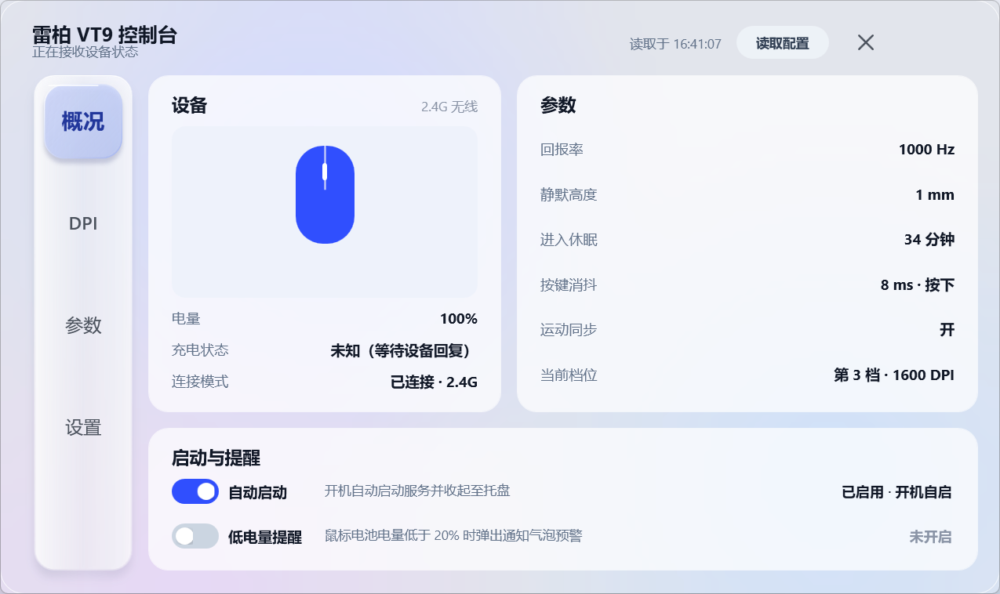

# VT9 状态 · 雷柏 VT9 控制台

Windows 上给雷柏 VT9 无线鼠标用的状态监视 + 配置工具。单个 `VT9Status.exe` 免安装运行，
直接用厂商 HID 集合读数据，**不装内核驱动、不联网、不上传任何东西**。



## 能做什么

- **实时状态**：DPI、电量、充电状态、连接模式（2.4G 无线 / 有线）。普通报告被动接收，
  充电状态走独立的只读电池查询，不根据电量上涨去猜充电。
- **托盘电量环**：环长随真实电量变化；20–40% 琥珀、低于 20% 红色、充电绿色加闪电；
  无线 / 有线 / 充电用中心图形区分；随任务栏深浅色自动反色，随 DPI 选 16 / 20 / 24 / 28 / 32px。
- **四个页面**：概况 / DPI / 参数 / 设置。
  - DPI：7 档开关 + 滑轨 + ±50 微调 + 一键快捷切档；
  - 参数：回报率、静默高度、进入休眠、按键消抖（按下 / 抬起分别写）、运动同步；
  - 设置：卡片与整窗透明度、自启动、低电量提醒、运行环境信息。
- **写入都走「读 → 改 → 写 → 回读」**：只有回读一致才提示成功，失败不会宣称成功。
- **界面**：WPF + DWM 原生 Acrylic 背景、五层透镜 Dock 导航、可打断的切页与换档动效。
- **其它**：单实例、登录自启动、低电量通知、诊断开关（见下）。

## 运行环境

- Windows 10 / 11 x64
- .NET Framework 4.8（系统自带；不需要安装运行时）
- 免安装：解压后双击 `VT9Status.exe`，同目录需保留 `VT9Status.exe.config`

目前只适配本机实测过的接收器 `VID_24AE / PID_1849` 与有线接口 `VID_24AE / PID_4191`，
不承诺其他 VT9 代际或固件可用。

## 构建

用系统自带的 .NET Framework 编译器，不依赖 NuGet / Python：

```powershell
powershell -NoProfile -ExecutionPolicy Bypass -File .\build.ps1
```

一键打包（编译 → 版本校验 → 自检 → 可选截图 / 归档 / 压缩 / 装机）：

```powershell
# 只出包到 dist\VT9Status-<当前版本>\
powershell -NoProfile -ExecutionPolicy Bypass -File .\pack.ps1

# 升版本 + 截图 + 压缩 + 归档 + 装到根目录
powershell -NoProfile -ExecutionPolicy Bypass -File .\pack.ps1 -Version 1.18.0 -Preview -Zip -Archive -Install
```

| 参数 | 作用 |
| --- | --- |
| `-Version x.y.z` | 先改 `src\AssemblyInfo.cs` 的版本号再编译 |
| `-Preview` | 额外截四页预览图，放进产物的 `预览\` |
| `-Zip` / `-Archive` | 产出 zip；快照到 `backup\<版本>-<时间戳>\` |
| `-Install` | 等旧实例退出后把当前源码编译到仓库根目录 |
| `-SkipSelfTest` | 跳过自检 |

## 诊断开关

| 开关 | 作用 |
| --- | --- |
| `--self-test` | 跑内置自检（当前 105 项）并写 `data/self-test.json` |
| `--diagnose [秒]` | 无界面采样，默认 20 秒，范围 5–300 |
| `--dpi-read-test` | 只读读取 DPI 档位与活动索引（`deviceWrites` 恒为 0） |
| `--config-dump` | 只读七个配置块原始字节，供与官方驱动差分 |
| `--charge-test` | 查询一次充电状态 |
| `--manual-check` | 释放并重连状态接口，验证能否收到新报告 |
| `--icon-preview` / `--tray-icon-preview` | 生成应用图标 / 托盘电量环的尺寸预览图 |
| `--ui-preview [--page=dpi\|params\|settings]` | 渲染界面并截图 |
| `--ui-preview-bg` | 同上，并在窗口后铺彩色测试背景，用来检查毛玻璃 |
| `--tray` | 启动界面但收在托盘 |
| `--tray-shot` | 截取任务栏里这颗图标的实际像素，用于验证缩放效果 |

程序是 GUI 子系统，在 PowerShell 里要 `Start-Process ... -Wait` 才会等到结束。

## 目录结构

```
src/                  全部 C# 源码（界面、HID 读取、配置读写、托盘、自检）
build.ps1             编译脚本（csc / .NET Framework 4.8）
pack.ps1, pack.cmd    一键打包
assets/               应用图标（由程序自己矢量导出）
docs/                 设计稿、动效与 SVG 说明、界面截图
patches/              历史改动的独立补丁与合并清单
验证记录-*.md          每个版本的验证材料：做了什么、怎么验的、哪些没验
使用说明.md            面向使用者的完整说明（含读数与协议细节）
```

运行期产物（`data/`、`dist/`、`bin/`、`artifacts/`、`backup/`、`experiments/`）不纳入仓库。

## 已知限制

- 只适配实测过的 `VID_24AE / PID_1849`、`VID_24AE / PID_4191` 两台设备。
- 写入通道只允许五个块：活动档 `0x898`、档位表 `0x888`、回报率 `0x880`、引擎 `0x884`、
  时序 `0x8C0`；角度 `0x8C4` 与 Y 轴表 `0x8C8` 只读。
- 不动系统级设置（Windows 指针速度、滚轮行数），这些改的是整机而不是这只鼠标。
- Windows 11 会把新出现的托盘图标先放进「隐藏的图标」抽屉，需要手动拖到任务栏，
  或把 `HKCU\Control Panel\NotifyIconSettings\<exe 对应项>` 的 `IsPromoted` 设为 1。
- 官方驱动、休眠恢复、断电后配置保持等场景仍待实机复核，详见各版本 `验证记录`。

## 版本

当前 **1.18.4**。逐版改动与验证结论见：

`验证记录.md`、`验证记录-1.1.md` … `验证记录-1.18-SVG改版.md`、
`验证记录-1.18.1-托盘可见性.md`、`验证记录-1.18.2-关闭路径与顶栏收敛.md`、
`验证记录-1.18.3-托盘菜单.md`、`验证记录-1.18.4-菜单锚点.md`。

## 隐私

正常监控不联网、不写状态文件、不采集按键 / 移动 / 滚轮数据。`data/app.log` 只记连接与异常，
单文件超过 1MB 轮换并只保留一个旧文件。

## 参考

- 协议参考：[OpenMouse-Project / mouse-protocol](https://github.com/OpenMouse-Project/mouse-protocol)
- 电量查询参考：[Tsifrokayf / Device-Battery-Tray](https://github.com/Tsifrokayf/Device-Battery-Tray)

本程序为独立编写，与雷柏官方无关。
